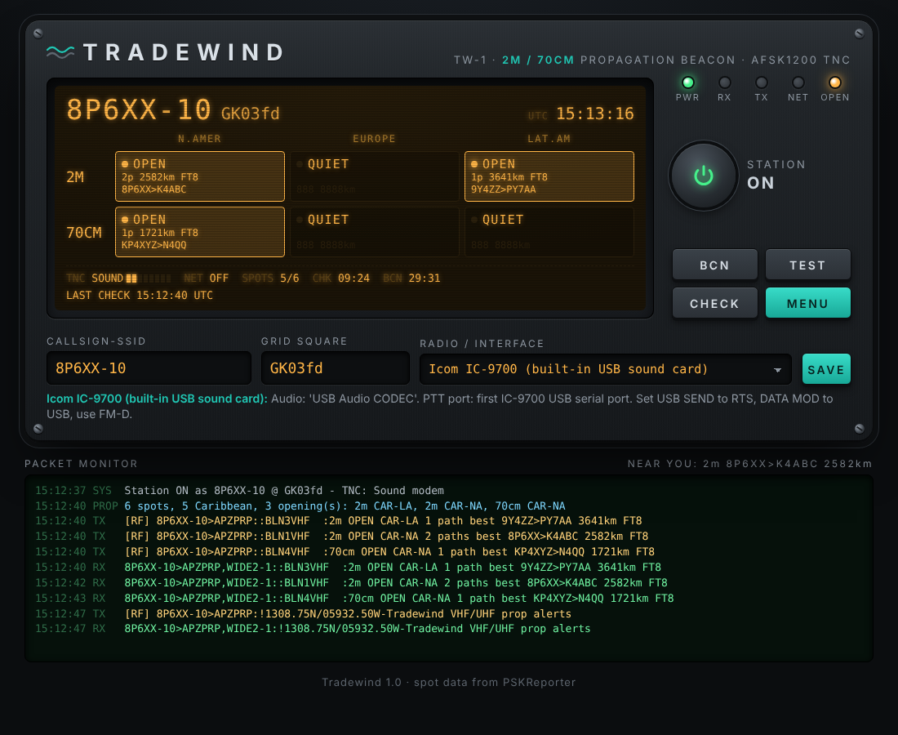

# Tradewind — Caribbean 2m/70cm propagation beacon & soundcard TNC

Tradewind watches PSKReporter for 2m and 70cm digital-mode spots (FT8, FT4,
MSK144, Q65…) and announces openings between the **Caribbean** and
**North America, Europe and Latin America** as APRS bulletins, on RF and/or
APRS-IS. It has its own AFSK 1200 sound modem, so a PC soundcard or a radio's
built-in USB sound card works as the TNC. You don't need Direwolf or
hardware, though both are supported.



## Download

Go to the **Releases** page (right-hand side of this repository) and download:

| Device | File | What works |
|---|---|---|
| Windows PC | `Tradewind.exe` | Everything: sound modem, USB radios (IC-9100, IC-705, FT-991A…), interfaces, KISS, APRS-IS, iGate |
| Android phone | `Tradewind.apk` | Propagation alerts over APRS-IS, or over Wi-Fi to a networked TNC (Direwolf / UZ7HO via KISS TCP) |

An `.exe` only runs on Windows, and Android uses `.apk` files. Both are built automatically from this code.

**Windows**
1. Double-click `Tradewind.exe`. A console window opens and your browser shows the face plate.
2. If SmartScreen warns about an unknown publisher, click **More info → Run anyway**. The .exe isn't code-signed.
3. Closing the console window stops Tradewind.

**Android**
1. Download `Tradewind.apk` on the phone and tap it.
2. Allow **Install unknown apps** for your browser or file manager when asked.
3. Play Protect may warn about an unknown developer. Tap **Install anyway**.
4. Keep the app open while you want alerts sent. Android may pause apps in the background,
   so you may need to exempt Tradewind from battery optimisation.

Radios that connect by USB cable or audio (soundcard, CI-V, CAT, Digirig) need the Windows/PC version.
Android's audio and USB systems aren't reachable from this app.

### Phone as a remote control

You can also run `Tradewind.exe --host 0.0.0.0` on the station PC and open
`http://<PC's IP address>:8073` in any phone browser on the same Wi-Fi. That gives you full control of the
PC's radio from the phone. Only do this on a trusted network.

You don't need Tradewind to *receive* alerts. APRSdroid, a TH-D74/D75 or FTM-500, or aprs.fi all show the bulletins.

## Run from source (Windows, macOS, Linux)

```
pip install -r requirements.txt
python3 app.py
```
Your browser opens the face plate at http://127.0.0.1:8073.

- **Windows/macOS:** `pip install sounddevice` includes PortAudio.
- **Linux:** also install PortAudio: `sudo apt install libportaudio2`.
- **APRS-IS only or KISS TNCs:** numpy and sounddevice are only needed for the built-in sound modem.

## Building the .exe

**Automatic.** Every push to `main` builds `Tradewind.exe` and `Tradewind.apk` on GitHub. Download them under
**Actions → latest run → Artifacts**. The first Android build takes 20–40 minutes; later ones are cached.
To publish a version for everyone:

1. Go to **Releases → Draft a new release**.
2. Create a new tag such as `v1.0` and publish.
3. Wait for both builds. They attach `Tradewind.exe` and `Tradewind.apk` to the release.

**On your own PC.** Install Python from python.org, then double-click `build_exe.bat`.
The result is `dist\Tradewind.exe`.

## First run

1. Type your **callsign-SSID** (e.g. `8P6XX-10`) and **grid square** (e.g. `GK03fd`).
2. Pick your **radio / interface**. A note under it shows the radio menu settings to make.
3. Press **MENU**, then **RADIO / TNC**, and choose the audio in/out devices and PTT port.
4. Press **SAVE**, then the **power button**.

To reach the face plate from a phone on the same Wi-Fi, run `python3 app.py --host 0.0.0.0`.
Only do this on a trusted network: anyone who can open the page can key your transmitter.

## TNC options

| Mode | Use for |
|---|---|
| Built-in sound modem | IC-9100, IC-705, IC-9700, IC-7100, FT-991A (built-in USB audio); FT-2980R, FT-7900R/8800R/8900R, FTM-400/300/200 and other radios via Digirig, SignaLink, AIOC or CM108 interfaces |
| KISS TCP | Direwolf (port 8001), UZ7HO Soundmodem (port 8100) |
| KISS serial | Kenwood TH-D74 / TH-D75 / TM-D710 built-in TNC, Mobilinkd |
| None | APRS-IS only |

These PTT methods are supported:
- VOX
- Serial RTS or DTR (Icom, Yaesu, Digirig, AIOC)
- CM108 GPIO (Linux `/dev/hidrawN`)
- Icom CI-V command (IC-9100 and other Icoms, no extra software needed)
- Yaesu CAT command `TX1;` (FT-991A and newer Yaesu radios)
- Hamlib `rigctld` for CAT PTT on any radio Hamlib supports

### Radio notes

- **Icom IC-9100.** Uses one USB cable for audio and control. Pick "USB Audio CODEC" for audio, set PTT to Icom CI-V, address `7C`, 9600 baud. On the radio, set DATA MOD to USB. Tradewind tunes the radio to the APRS frequency in FM data mode for you. Close loggers and WSJT-X first, because only one program can use the CI-V port.
- **Yaesu FT-2980R.** Has no data jack and no CAT port. Connect through the mic jack and the external speaker jack with a SignaLink (VOX) or a Digirig with a Yaesu mic cable (Serial RTS). Check the cable's mic-jack pinout against the radio manual. Keep TX audio low, and use Low or Mid power for long sessions.
- **Yaesu FT-7900R / FT-8800R / FT-8900R / FTM-400 / FTM-300 / FTM-200.** Use the rear DATA jack at 1200 bps with a soundcard interface cable for that model.

### Automatic tuning (CAT)

Tick **Tune the radio to the APRS frequency** (MENU → RADIO / TNC) and pick a frequency:
144.390, 144.800, 144.930, 145.570, 145.825 (ISS digipeater) or your own.
When the station turns on, Tradewind sets the radio to that frequency in FM data mode (FM-D / DATA-FM).
When it turns off, it puts the radio back on the frequency and mode it was using before.

Tuning works when the PTT method is a CAT link:
- **Icom CI-V**: IC-9100 (address 7C), IC-705 (A4), IC-9700 (A2), IC-7100 (88)
- **Yaesu CAT**: FT-991A and newer Yaesu radios
- **Hamlib rigctld**: any radio Hamlib supports

Radios without a CAT port, such as the FT-2980R, have to be set by hand.
If you choose 145.825 for the ISS, set the RF path to `ARISS`, and only transmit while the ISS is overhead.

## Live propagation map

Below the face plate, a map draws every Caribbean 2m/70cm path that PSKReporter saw during the look-back window.
Lines are coloured by mode (TEP orange, tropo duct teal, Sporadic-E pink); 2m lines are solid and 70cm lines dashed.
Hover over or tap a line to see the stations, distance, digital mode and signal report.
The map refreshes after every check, which is every 10 minutes by default.
It needs an internet connection for the map tiles.

## Face plates

Use the **FACE PLATE** buttons at the top of the page to switch looks at any time. Each device remembers its own choice.
- **Classic:** the original radio-style panel.
- **Ops Console:** a desktop dashboard with a side menu, status chips, opening cards, the live map, an alert center, chat and the packet log.
- **Field:** a light, high-contrast phone layout with a big power button, an "open now" card and large Beacon / Menu / Check buttons.

All settings stay under **MENU** (or **Settings** in the Ops Console).

## Two-way chat (2m / 70cm)

You can chat station to station using standard APRS messages, with a handshake so both operators agree first:

1. Type the other station's callsign under **TWO-WAY CHAT**, choose how to send, and press **HAIL**.
   **RF only** is a real test of the propagation path.
2. Their Tradewind plays a call-out tone and shows **Accept / Decline**.
3. When they accept, you get **"accepted - press Accept to confirm"**. Press **Accept**.
4. The link opens on both sides and you can chat. **End link** closes it.

Every message is numbered and resent (after 30, 60 and 120 s) until the other station acknowledges it, and each one shows *sending*, *delivered* or *not delivered*.
A completed handshake over RF proves the path works both ways.
Operators using APRSdroid, a TH-D74/D75 or another APRS radio can take part too: they see the request as a message and reply **ACCEPT** or **DECLINE**. Plain APRS messages they send you appear in the chat, and you can reply.

### Built for outages, disasters and off-grid travel (v2.0)

- **Works with no internet.**
  - RF chat, forms, the heard-stations list and the logs all run without internet.
  - The map library and every map area you have viewed are saved on the computer.
  - Open Tradewind once while online, and pan around the islands you care about, so the map is ready for an outage.
- **Hail retries.** Choose how often a hail repeats: once, 4 times, 10 times or **until received**, every 30 s to 15 min. "Until received" keeps calling through a fading opening until the other station's radio acknowledges it.
- **Stations heard on RF.** A live list of every station your radio decodes, with last-heard time, packet count and whether it was direct or through a digipeater. A **HAIL** button sits next to each one.
- **Chats survive restarts and power cuts.** They are saved to disk; commercial-mode chats are saved encrypted.
- **ICS-309 communications log.** **DOWNLOAD LOG (ICS-309)** saves every chat message as a spreadsheet (CSV) with local and UTC time, from, to and route, ready for an EmComm after-action report.
- **HF chat.** Choose the **300 baud HF** modem (1600/1800 Hz on USB) under MENU > RADIO / TNC to use the chat and forms on HF.
- **More radios.**
  - **Icom:** IC-7300, IC-7610, IC-2730 / IC-5100.
  - **Kenwood:** TS-590 / TS-890, TM-V71.
  - **Yaesu:** FT-710 / FTDX10 / FTDX101, FT-5DR / FT-3DR / FT-65.
  - **Xiegu:** X6100, G90 / G106.
  - **Radtel / Quansheng / Baofeng:** RT-890, RT-4D, UV-K5, UV-5R (AIOC cable).
- **Help everywhere.** Hover over any setting, or tap its **?**, for a plain explanation.

### Multi-speed links and automatic link selection (v3.0, Phase 2)

Add a **second radio link** under MENU > RADIO / TNC, for example 70cm at 9600 baud through Direwolf next to your 2m 1200-baud radio. Choose **Auto** under "Send via" in the chat, and Tradewind:
- measures delivery, round-trip time and throughput for each station on each link;
- sends on the link with the best expected throughput (faster links are preferred while they deliver);
- **falls back** to the slower link after two lost tries in a row, and **tries the faster link again** after 10 minutes;
- resends only the messages that were lost, because each message or form part is acknowledged on its own;
- returns acknowledgements on the link the message arrived on.

**PROBE** in the chat sends a short test on each link and shows the reply time.
**MAKE A DIREWOLF SETUP FILE** writes a ready-to-use Direwolf configuration for 1200 AFSK, 2400 QPSK, 4800 8PSK or 9600 G3RUH, with IL2P or FX.25 error correction.
The second link can also be UZ7HO Soundmodem, VARA FM (KISS port) or a hardware KISS TNC. Speeds above 1200 need a radio data port that supports them; 9600 needs a "9600" data port.

### Tradewind Robust: weak-signal text for HF / SSB (Phase 3)

A modem built for paths that are too weak for packet radio. Choose **Tradewind Robust** as the modem under MENU > RADIO / TNC and use USB (upper sideband).

**How it works:**
- 8-FSK at 31.25 baud: a 250 Hz-wide signal centred near 1.5 kHz.
- Rate-1/2 convolutional coding (K=7) with soft-decision Viterbi decoding, an interleaver and a CRC.
- A Costas-array preamble finds the signal in time and frequency, so tuning errors up to about ±200 Hz are tolerated.

**Performance:** about **44 bit/s**, so a chat message takes 10–20 s on air. In simulation (white noise, 2.5 kHz bandwidth) it decodes reliably down to **about -12 dB SNR**, below the point where the signal is audible. Real HF fading and interference will cost some of that margin, so test on the air before relying on it.

Chat, forms, store-and-forward and relay all work over it, with longer resend times. Both stations need Tradewind Robust; it does not talk to other modems.

### Off-grid and disaster features (Phase 4)

- **Store and forward.** A message that cannot be delivered is kept for up to 24 h. It is resent automatically as soon as that station is heard on the air again (any packet or beacon), and survives a restart.
- **Relay through another station.** Under **SEND THROUGH A RELAY STATION**, give a relay station and a final destination. The relay passes the message on, marked "de <you> via <relay>", and tells you when it is delivered. The relay must tick **Act as a relay** (MENU > STATION).
- **Net check-ins.** The **Net check-in** form sends status (Safe / Need help / Emergency / Evacuated), location and number of people. Net control gets a live **NET CHECK-INS** roster.
- **Works with no internet.** Everything above runs over RF alone; see v2.0.

### Message forms

The **FORMS** button in the chat sends short structured reports, styled on Winlink / ICS forms:
- SITREP
- weather observation (spot report)
- forecast relay (the latest Tradewind weather bulletin)
- damage assessment
- shelter status
- medical / casualty report
- resource request
- welfare check
- general message (ICS-213 style)

Each form becomes one or more numbered messages of up to 67 characters, e.g. `WXOBS 201225L 1/3 Ocean City, St Philip. Wind ENE 35 G50kt...`. Each message is acknowledged like any other chat message.

## Good-neighbour limits (v3.2)

Tradewind has limits built in so it can't be used, by mistake or on purpose, to flood the channel or pester other stations.

| Area | Limit |
|---|---|
| PSKReporter | at most 6 checks an hour, at least 10 minutes apart |
| Beacons and bulletins | the same text goes out at most twice an hour; position beacon no more often than every 30 minutes |
| Hailing | at most 5 calls, at least 1 minute apart; "until received" stops after 30 minutes |
| After a "no" | you can't hail that station again for 15 minutes |
| Nuisance callers | a station that calls you more than 3 times in 10 minutes is muted for 1 hour; BLOCK ignores a station completely |
| Chat messages | one unanswered message per station at a time, at least 30 seconds apart (later messages wait their turn) |
| Probes | at most 4 an hour |
| Relay | at most 10 an hour; a message that was already relayed is never relayed again |
| Store and forward | at most 10 waiting messages per station, 50 in all, kept 24 hours |
| Airtime | at most 10% of any 10 minutes on VHF/UHF packet (25% in Robust HF mode, where one message takes 12-45 s) |
| Transmit watchdog | PTT is forced off if one transmission runs past 10 s (1200 baud), 20 s (300 baud) or 50 s (Robust) |
| Digipeater path | at most 2 hops (WIDE1-1,WIDE2-1 or WIDE2-2); WIDE3 and above, RELAY and TRACE are refused |
| Callsign | nothing is sent until a real callsign is set (N0CALL and similar are refused) |
| Station PIN | phones and other computers on your network need the PIN to open Tradewind; "Lock settings" also asks for it before settings or the network key change |
| Commercial passphrase | at least 12 characters |

## Commercial / EmComm mode (encrypted, 148-174 MHz)

For organisations with a **licensed commercial or emergency-services VHF channel**, MENU > COMMERCIAL switches Tradewind to an encrypted chat.

**What it does:**
- Message content is encrypted with **AES-256-GCM**, using a 256-bit key derived (scrypt) from a shared network name and passphrase.
- Messages are authenticated, so an altered or forged message is rejected.
- Old or replayed messages are refused.
- Units compare a short **key fingerprint** to confirm they hold the same key.

**Rules it enforces:**
- Only works on **148.000-174.000 MHz**. Amateur frequencies are refused, because amateur rules do not allow encryption.
- APRS bulletins, beacons and APRS-IS are switched off in this mode.
- Each unit sends a **clear station ID** (your licence call sign) at the start of a session and every 30 minutes by default. Unit IDs travel in clear; only the content is encrypted.

**Limits:**
- Needs the Windows/PC version and a radio licensed for that channel.
- Many amateur transceivers cannot transmit outside the amateur bands; use a radio type-approved for the commercial channel.
- Check your licence conditions with the national regulator.
- Have the encryption independently reviewed before relying on it for sensitive operations.

## Setting TX audio

Use **MENU → STATION → BCN** to send a beacon while you adjust the TX audio level. Aim for about 3 kHz deviation, which is clean, unclipped audio on a monitor receiver. Keep RX audio at roughly 30–50% on the face plate meter.

## What gets sent

- **Bulletins.** `BLN1VHF`–`BLN6VHF` carry one line each for 2m and 70cm × NA/EU/LA, e.g. `2m OPEN CAR-NA 2 paths best 8P6XX>K4ABC 2582km FT8`. Each is repeated every 30 minutes while the opening lasts. `BLN9` is the TEST button.
- **Position beacon.** The centre of your grid square, every 30 minutes (optional).
- **Optional RX iGate.** Packets heard on RF are gated to APRS-IS.

## Propagation modes

Tradewind labels every Caribbean opening with its likely mode and lets you choose which modes to watch,
which ones switch RF on, and which ones sound an alert (MENU → PROPAGATION and MENU → RADIO / TNC).

| Mode | Shown as | How it's recognised |
|---|---|---|
| **TEP** (trans-equatorial) | `TEP` | Path to South America that crosses the equator (far station south of 5° S) |
| **Tropospheric ducting** | `DUCT` | 70cm, paths longer than 2,300 km, trans-Atlantic paths (Europe, Canaries, Madeira, Azores, Cape Verde), or outside Es season |
| **Sporadic-E** | `Es` | 2m, 800–2,300 km, May–Aug and Dec–Jan, daytime and evening |

Bulletins include the mode, e.g. `2m TEP OPEN CAR-LA 1 path best 9Y4ZZ>PY7AA 3641km FT8`.
The labels are best guesses from path geometry, band and season; they can't measure the mode directly.

## Weather bulletins (optional)

Tradewind can send scheduled APRS weather bulletins (MENU → WEATHER). Defaults for Barbados:

| Bulletin | Default times (local) | Sent as | Source |
|---|---|---|---|
| General forecast | 08:00 | `BLN1WX`… | Open-Meteo |
| Marine (seas, swell, wind, small-craft caution) | 05:30, 12:00 | `BLN1MAR`… | Open-Meteo Marine |
| Aviation: TBPB METAR + TAF, Piarco FIR (TTZP) SIGMETs | 06:30, 18:00 | `BLN1AVN`… | aviationweather.gov |

**Tropical cyclone alerts** (on by default): every 20 minutes Tradewind checks the National Hurricane
Center. When an Atlantic system is within 1,500 km of Barbados (adjustable), or an NHC advisory puts
Barbados under a hurricane or tropical storm watch/warning, it sends `BLN1TC`… bulletins with each new
advisory, e.g. `HU BERYL adv 010: 12.1N 57.6W 115kt 961mb mov WNW 20mph` /
`Hurricane BERYL is 244km ESE of Barbados` / `HURRICANE WARNING IN EFFECT FOR BARBADOS`.
The face plate chimes and speaks the alert.

These are automated, unofficial summaries. For official forecasts and warnings use the
Barbados Meteorological Services and the Department of Emergency Management.
Grantley Adams (TBPB) lies within the Piarco FIR (TTZP).

## Tuning

**Default rule:** a band counts as open when there are at least 2 distinct Caribbean paths of 800 km or more, or one path of 1500 km or more. Both thresholds are in **MENU → PROPAGATION**.

**Query limit:** Tradewind checks PSKReporter at most 6 times an hour, with at least 10 minutes between checks. The same beacon or bulletin text is sent at most twice an hour, and the position beacon is never more often than every 30 minutes.

## Testing offline

```
python3 app.py --demo saved_pskreporter.xml
```
Save a PSKReporter response from `https://retrieve.pskreporter.info/query?frange=144000000-450000000&flowStartSeconds=-3600&rronly=1`.

## Files

| File | What it is |
|---|---|
| `app.py` | Station logic and web server |
| `faceplate.html` | The face plate UI |
| `afsk.py` | AFSK 1200 modem and AX.25 framing |
| `tnc.py` | Sound modem, KISS TCP/serial, PTT drivers, APRS-IS client |
| `vhf_prop_aprs.py` | PSKReporter fetch and opening detection; also runs alone from the command line |

Settings are stored in `~/.tradewind/config.json`.

Transmitting requires an amateur licence. Use your own callsign.

## Credits & licence

Tradewind was created by **Brandon St Rose (8P5DG)** and **Kammie Holder (8P5AB)**, Barbados.

It's released under the [MIT License](LICENSE). You're free to use, share and modify it, including
in your own projects, as long as you keep the copyright notice and licence text. Spot data comes from
[PSKReporter](https://pskreporter.info). Transmitting requires an amateur licence; use your own callsign.
